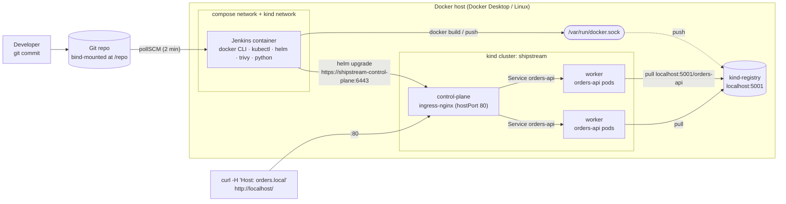
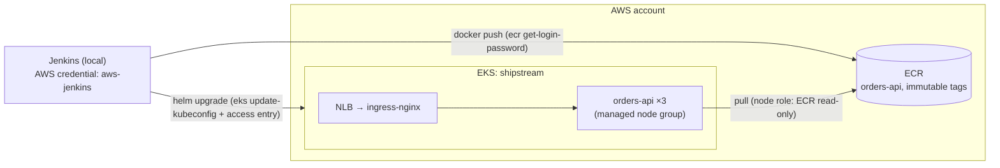
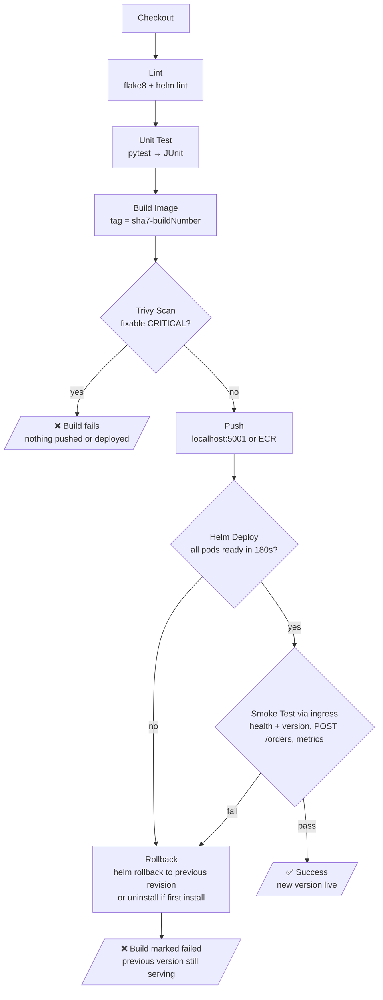

# ShipStream: CI/CD to Kubernetes (`shipstream-cicd-k8s`)

Every commit to a small Python microservice is linted, tested, built, scanned, deployed to Kubernetes with Helm, and smoke-tested through the ingress. If the deploy or smoke test fails, the release is rolled back automatically. It all runs on a laptop by default (Jenkins in Docker, kind, a local registry), and an **AWS mode** swaps in ECR and EKS without changing the pipeline.

## Contents

- [Overview](#overview)
- [Architecture](#architecture)
- [Prerequisites](#prerequisites)
- [Local Setup](#local-setup)
- [AWS Setup](#aws-setup)
- [Pipeline Stages](#pipeline-stages)
- [Troubleshooting](#troubleshooting)
- [Screenshots](#screenshots)
- [What I Learned](#what-i-learned)

---

## Overview

**orders-api** is a FastAPI service with:

| Endpoint | Purpose |
|---|---|
| `GET /health` | Liveness/readiness probe target; returns `{"status":"ok","version":"<image tag>"}` |
| `POST /orders` | Create an order (201) |
| `GET /orders` | List orders |
| `GET /orders/{id}` | Get one order (404 if unknown) |
| `PUT /orders/{id}` | Replace an order |
| `DELETE /orders/{id}` | Delete an order (204) |
| `GET /metrics` | Prometheus metrics: request count and latency by route template, orders created, orders stored |
| `GET /docs` | OpenAPI UI (FastAPI built-in) |

Storage is **in-memory and per pod** on purpose: the service exists to exercise the pipeline, not to store data (see [Troubleshooting](#troubleshooting)).

What the project demonstrates:

- A **multi-stage, non-root** Docker image (UID 10001) that runs with a read-only root filesystem and no Linux capabilities
- Kubernetes manifests **and** an equivalent Helm chart: 3 replicas, resource requests and limits, liveness/readiness probes, rolling updates with zero unavailability, a PodDisruptionBudget, topology spread across nodes, and the `restricted` Pod Security Standard
- A **declarative Jenkinsfile** with a security gate (Trivy fails the build on fixable CRITICAL CVEs) and an automatic **rollback stage**
- **Jenkins as code**: plugins, the admin user, credentials and the job are all provisioned by JCasC, so you never click through the setup wizard
- **One pipeline, two targets**: `DEPLOY_TARGET=local` (kind + `localhost:5001`) or `aws` (EKS + ECR)

### Repository layout

```text
.
├── Jenkinsfile                  # the pipeline
├── orders-api/                  # the service
│   ├── orders_api/              #   main.py, models.py, store.py, metrics.py
│   ├── tests/                   #   pytest unit tests
│   ├── Dockerfile               #   multi-stage, non-root
│   └── requirements*.txt
├── k8s/                         # plain manifests (Namespace, Deployment, Service, Ingress) + kustomization
├── helm/orders-api/             # the same app as a Helm chart (+ values-aws.yaml, helm test)
├── kind/kind-config.yaml        # 1 control-plane + 2 workers, ports 80/443 mapped
├── jenkins/                     # Dockerfile, docker-compose.yml, casc.yaml, plugins.txt
├── scripts/
│   ├── local-up.sh / local-down.sh   # create / destroy registry + kind + ingress
│   └── ci/                      # helm-deploy.sh, smoke-test.sh, rollback.sh (called by Jenkins)
├── aws/                         # eksctl cluster config, IAM policy for Jenkins
└── docs/                        # aws-mode.md, screenshots/
```

---

## Architecture

### Local mode (default)



Key wiring that makes this work:

- **Jenkins → Docker:** the host's Docker socket is mounted into Jenkins, so builds run on the host daemon. There's no Docker-in-Docker.
- **Jenkins → Kubernetes:** Jenkins joins the `kind` Docker network and uses `kind get kubeconfig --internal`, which addresses the API server by container name instead of `127.0.0.1`.
- **Nodes → registry:** each node's containerd has a `hosts.toml` that maps `localhost:5001` to `http://kind-registry:5000`. The image name is therefore identical on the host (where you push) and inside the cluster (where pods pull).
- **You → app:** kind maps host port 80 to the control-plane node, where ingress-nginx listens and routes `Host: orders.local` to the Service.

### AWS mode



Full walkthrough: **[docs/aws-mode.md](docs/aws-mode.md)**.

### Pipeline flow



Any failure before **Push** stops the pipeline, and nothing reaches the cluster. Once **Helm Deploy** starts, failures are caught (`catchError`) rather than aborting the pipeline, so the **Rollback** stage always gets to run.

---

## Prerequisites

| Tool | Version targeted | Notes |
|---|---|---|
| Docker Desktop (WSL 2 backend) or Docker Engine | 4.x / 27+ | Give it **≥ 6 GB RAM**: 3 kind nodes + Jenkins |
| kind | v0.33.0 | `winget install Kubernetes.kind` / `brew install kind` |
| kubectl | v1.37 | `winget install Kubernetes.kubectl` / `brew install kubectl` |
| Helm | v3.22 (v4 also works) | `winget install Helm.Helm` / `brew install helm` |
| Python | 3.12 | Only for running the service and tests outside Docker |
| bash | Git Bash, WSL, macOS or Linux | The scripts are bash. On Windows, use **Git Bash** or WSL |
| curl, jq | any | jq is only needed on the host if you run `scripts/ci/*` by hand |

Free ports needed on the host: **80, 443** (ingress), **5001** (registry), **8080** (Jenkins).

For AWS mode you also need the `aws` CLI v2, `eksctl` and an AWS account. See [AWS Setup](#aws-setup).

---

## Local Setup

Run everything from the repo root in **Git Bash** (Windows), WSL, or a macOS/Linux terminal.

### Step 1: Run the service and its tests on your machine

```bash
cd orders-api
python -m venv .venv
source .venv/bin/activate            # Git Bash on Windows: source .venv/Scripts/activate
pip install -r requirements-dev.txt

flake8 .                             # lint, same config as CI (.flake8)
pytest                               # 17 unit tests

APP_VERSION=dev uvicorn orders_api.main:app --reload --port 8000
```

In a second terminal:

```bash
curl localhost:8000/health
# {"status":"ok","version":"dev"}

curl -X POST localhost:8000/orders -H 'Content-Type: application/json' \
  -d '{"customer":"acme","item":"widget","quantity":2,"unit_price":9.99}'
# {"customer":"acme",...,"id":"<uuid>","status":"pending",...}

curl localhost:8000/orders
curl localhost:8000/metrics | grep '^orders_api'
```

Stop uvicorn (Ctrl+C), then run `deactivate` and `cd ..`.

### Step 2: Build and run the container image

```bash
docker build -t orders-api:0.1.0 --build-arg APP_VERSION=0.1.0 orders-api
docker run --rm -d -p 8000:8000 --name orders-api orders-api:0.1.0

curl localhost:8000/health                    # {"status":"ok","version":"0.1.0"}
docker exec orders-api id                     # uid=10001(app) gid=10001(app): not root
docker inspect --format '{{.State.Health.Status}}' orders-api   # healthy (after ~10s)
docker image ls orders-api                    # the final stage has no pip cache or build tools

docker stop orders-api
```

### Step 3: Create the local platform (registry + kind + ingress)

One command does it all, and it is safe to re-run:

```bash
./scripts/local-up.sh
```

Here is what it runs, step by step, so you can do it by hand and understand each piece:

```bash
# 3a. A local registry. Port 5001 because macOS AirPlay often owns 5000.
docker run -d --restart=always -p 127.0.0.1:5001:5000 --network bridge --name kind-registry registry:2

# 3b. The cluster: 1 control-plane + 2 workers. Host ports 80/443 → control-plane,
#     which is labelled ingress-ready=true.
kind create cluster --config kind/kind-config.yaml
kubectl get nodes                       # shipstream-control-plane, shipstream-worker, shipstream-worker2

# 3c. Tell each node's containerd that "localhost:5001" really means the registry container.
#     (Git Bash: export MSYS_NO_PATHCONV=1 first; see Troubleshooting)
for node in $(kind get nodes --name shipstream); do
  docker exec "$node" mkdir -p /etc/containerd/certs.d/localhost:5001
  printf '[host."http://kind-registry:5000"]\n' | \
    docker exec -i "$node" cp /dev/stdin /etc/containerd/certs.d/localhost:5001/hosts.toml
done

# 3d. Put the registry on the kind network so nodes can resolve "kind-registry".
docker network connect kind kind-registry

# 3e. ingress-nginx, kind flavour (hostPort 80/443 on the ingress-ready node).
kubectl apply -f https://raw.githubusercontent.com/kubernetes/ingress-nginx/controller-v1.15.1/deploy/static/provider/kind/deploy.yaml
kubectl wait -n ingress-nginx --for=condition=ready pod \
  -l app.kubernetes.io/component=controller --timeout=180s

# 3f. A kubeconfig Jenkins can use from inside Docker: API = https://shipstream-control-plane:6443
mkdir -p jenkins/secrets
kind get kubeconfig --internal --name shipstream > jenkins/secrets/kubeconfig
```

> ingress-nginx was retired upstream in March 2026, and `controller-v1.15.1` is its final release. It's fine for a local lab. For anything long-lived, use a Gateway API implementation (e.g. Envoy Gateway) or your cloud's load-balancer controller.

### Step 4: Push the image to the local registry

```bash
docker tag orders-api:0.1.0 localhost:5001/orders-api:0.1.0
docker push localhost:5001/orders-api:0.1.0
curl http://localhost:5001/v2/orders-api/tags/list     # {"name":"orders-api","tags":["0.1.0"]}
```

### Step 5: Deploy with plain manifests

```bash
kubectl apply -k k8s/          # namespace, deployment, service, ingress (same as 4× kubectl apply -f)

kubectl -n shipstream rollout status deploy/orders-api
kubectl -n shipstream get pods -o wide          # 3 pods, spread over both workers
kubectl -n shipstream describe deploy/orders-api | grep -A3 -E 'Limits|Liveness|Readiness'
kubectl -n shipstream get ingress

curl -H "Host: orders.local" http://localhost/health
```

Optional: so you can type `http://orders.local/` without the header, add `127.0.0.1 orders.local` to your hosts file. That's `C:\Windows\System32\drivers\etc\hosts` on Windows (edit as Administrator) or `/etc/hosts` on macOS/Linux.

Things to try:

```bash
kubectl -n shipstream delete pod -l app.kubernetes.io/name=orders-api --wait=false   # self-healing
kubectl -n shipstream get pods -w
kubectl -n shipstream port-forward svc/orders-api 8000:80   # bypass the ingress
```

### Step 6: Deploy the same thing with Helm

The chart creates resources with the same names, so first remove the hand-applied ones. Keep the namespace, because it carries the Pod Security label (see [Troubleshooting #4](#4-helm-install-fails-with-exists-and-cannot-be-imported-into-the-current-release)):

```bash
kubectl -n shipstream delete deploy,svc,ingress orders-api

helm lint helm/orders-api --strict
helm template orders-api helm/orders-api -n shipstream --set image.tag=0.1.0 | less   # see the rendered YAML

helm upgrade --install orders-api helm/orders-api \
  --namespace shipstream --create-namespace \
  --set image.tag=0.1.0 \
  --wait --timeout 180s

helm list -n shipstream
helm test orders-api -n shipstream          # runs templates/tests/test-connection.yaml
curl -H "Host: orders.local" http://localhost/health
```

Try a manual upgrade and rollback:

```bash
docker build -t localhost:5001/orders-api:0.2.0 --build-arg APP_VERSION=0.2.0 orders-api
docker push localhost:5001/orders-api:0.2.0
helm upgrade orders-api helm/orders-api -n shipstream --set image.tag=0.2.0 --wait
curl -s -H "Host: orders.local" http://localhost/health        # version 0.2.0
helm history orders-api -n shipstream
helm rollback orders-api 1 -n shipstream --wait
curl -s -H "Host: orders.local" http://localhost/health        # version 0.1.0 again
```

### Step 7: Start Jenkins

Step 3 must have run first: Jenkins needs the `kind` network and `jenkins/secrets/kubeconfig`.

```bash
docker compose -f jenkins/docker-compose.yml up -d --build    # first build: ~3-5 min
docker logs -f shipstream-jenkins                              # wait for "Jenkins is fully up and running"
```

Check the toolchain from inside the container, as the `jenkins` user:

```bash
docker exec -u jenkins shipstream-jenkins docker version --format '{{.Server.Version}}'
docker exec -u jenkins -e KUBECONFIG=/run/secrets/shipstream/kubeconfig shipstream-jenkins kubectl get nodes
docker exec -u jenkins shipstream-jenkins sh -c 'helm version --short && trivy --version | head -1'
```

Open **http://localhost:8080** and log in as `admin` / `admin` (override with `JENKINS_ADMIN_PASSWORD=... docker compose ...`). JCasC has already created:

- the `kind-kubeconfig` credential (secret file)
- the `shipstream-orders-api` pipeline job, pointing at `file:///repo` (this repo, mounted read-only)

### Step 8: Run the pipeline

Jenkins builds **committed** code only, so commit first:

```bash
git add -A && git commit -m "ShipStream: initial pipeline"
```

In Jenkins, open **shipstream-orders-api → Build Now**. The first run also registers the job's parameters. After that, Jenkins polls for new commits every 2 minutes.

```bash
curl -s -H "Host: orders.local" http://localhost/health    # version = <git-sha>-<build-number>
helm history orders-api -n shipstream
curl -s http://localhost:5001/v2/orders-api/tags/list
```

Build artifacts: `reports/junit.xml` (shown as test results), `reports/flake8.txt` and `reports/trivy.txt`.

### Step 9: Watch a rollback happen

**Build with Parameters → `SIMULATE_SMOKE_FAILURE` = ✅ → Build**

The new version deploys, but the smoke test expects a different version and fails. **Rollback** then runs `helm rollback` to the previously deployed revision. The build ends red, and the old version keeps serving traffic:

```bash
helm history orders-api -n shipstream     # ... deployed → superseded → "Rollback to N"
curl -s -H "Host: orders.local" http://localhost/health    # previous version
```

For a more realistic failure, push a commit that breaks `/health` (e.g. make it return 500). The readiness probe never passes, `helm --wait` times out, and Rollback restores the previous revision. Because `maxUnavailable: 0`, the old pods keep serving throughout.

### Step 10: Tear down

```bash
./scripts/local-down.sh                  # Jenkins (incl. jenkins_home volume), kind cluster, registry
./scripts/local-down.sh --keep-jenkins   # keep Jenkins and its build history
```

---

## AWS Setup

AWS mode runs the **same Jenkinsfile and Helm chart** against ECR and EKS. Local mode stays the default; you opt in per build with `DEPLOY_TARGET=aws`.

Summary (full commands, IAM table and cleanup are in **[docs/aws-mode.md](docs/aws-mode.md)**):

1. **ECR:** `aws ecr create-repository --repository-name orders-api --image-tag-mutability IMMUTABLE --image-scanning-configuration scanOnPush=true`
2. **IAM:** create user `shipstream-jenkins` with [aws/iam-policy-jenkins.json](aws/iam-policy-jenkins.json). It allows ECR push to *this repo only* and `eks:DescribeCluster` on *this cluster only*.
3. **EKS:** `eksctl create cluster -f aws/eksctl-cluster.yaml`. Its access entry gives the Jenkins user **Edit in `shipstream`** and **View in `ingress-nginx`**, and nothing cluster-wide.
4. **Once, as admin:** install ingress-nginx behind an NLB, then `kubectl apply -f k8s/namespace.yaml`
5. **Jenkins:** add an *AWS Credentials* entry with ID `aws-jenkins` (in the UI, or the commented block in `jenkins/casc.yaml`)
6. **Run:** *Build with Parameters* → `DEPLOY_TARGET=aws`, `AWS_REGION`, `EKS_CLUSTER_NAME`

| | Local | AWS |
|---|---|---|
| Registry | `localhost:5001` | `<acct>.dkr.ecr.<region>.amazonaws.com` |
| Cluster | kind | EKS |
| Cluster credentials | `kind-kubeconfig` file credential | `aws eks update-kubeconfig` per build |
| Ingress address | `shipstream-control-plane` + `Host: orders.local` | NLB DNS name |
| Values | `values.yaml` | `values.yaml` + `values-aws.yaml` |

⚠️ EKS, the nodes and the NLB are billed hourly. Follow the cleanup section in the AWS doc as soon as you're done.

---

## Pipeline Stages

| # | Stage | What it does | Why it exists | Fails the build when |
|---|---|---|---|---|
| 1 | **Checkout** | `checkout scm`; computes `IMAGE_TAG = <sha7>-<build#>`, the registry, and the values file for the target | Every later stage works from one immutable, traceable tag, so you can always tell which commit is running | SCM unreachable; AWS mode: credentials invalid |
| 2 | **Lint** | `flake8` on the service; `helm lint --strict` on the chart | Cheapest feedback first. Style errors and broken templates fail in seconds, not after a 2-minute image build | Any flake8 violation; any chart error or warning |
| 3 | **Unit Test** | `pytest` with JUnit XML, published to Jenkins | Proves the API contract (status codes, validation, 404s, metric labels) before anything is packaged | Any failing test |
| 4 | **Build Image** | Multi-stage `docker build --pull` with `APP_VERSION` baked in and the git SHA as an OCI label | `--pull` picks up base-image security patches. The baked-in version is what the smoke test checks later | Dockerfile or dependency errors |
| 5 | **Trivy Scan** | Saves a full HIGH+CRITICAL report as an artifact, then gates on **CRITICAL with a fix available** | Stops known-exploitable images *before* they reach a registry. `--ignore-unfixed` keeps the gate actionable: a failure always means a fix exists | ≥1 fixable CRITICAL not listed in `.trivyignore` |
| 6 | **Push** | `docker push` to `localhost:5001` (or `docker login` + push to ECR) | Only scanned images get into the registry, so the cluster can only pull vetted images | Registry unreachable / auth denied |
| 7 | **Helm Deploy** | Records the current revision, then runs `helm upgrade --install --wait --timeout 180s` | Declarative, versioned releases with history. `--wait` treats "pods never got Ready" as a deploy failure, not a silent success | Pods not Ready in time (crash, bad probe, image pull error) |
| 8 | **Smoke Test** | Through the **ingress**: `/health` reports the *new* version on every sampled pod, `POST /orders` → 201, `GET /orders` → 200, `/metrics` exposes app series | Readiness only proves a pod answers `/health`. This proves the real path (ingress → service → pod) serves the new build | Any check fails after 30 retries (2.5 min) |
| 9 | **Rollback** | *Only if 7 or 8 failed:* prints diagnostics (history, pods, events), then `helm rollback` to the recorded revision, or `helm uninstall` if the first install failed | Leaves the cluster on the last known-good version, automatically and without anyone stepping in | Rollback itself fails (needs a human) |
| – | **post** | Archives `reports/**`, removes the local image, wipes the workspace | Keeps evidence and stops the host disk from filling up | never |

Design notes:

- **Why scan before push?** Pushing first would put an unvetted image somewhere `kubectl` could pull it. Scanning first means the registry holds only gated images.
- **Why tag `<sha>-<build#>` and not `latest`?** Rollback needs the old image to still exist under a name that never changes. Unique tags also allow ECR's `IMMUTABLE` setting.
- **Why does the smoke test never read an order back by ID?** Each of the 3 pods has its own in-memory store, so the read could land on a different pod and 404. That would test the load balancer, not the build.
- **Why scripts in `scripts/ci/` instead of inline `sh`?** You can run and debug them from your terminal with the same inputs Jenkins uses, without starting a build.

---

## Troubleshooting

### 1. Pods stuck in `ImagePullBackOff` for `localhost:5001/orders-api`

**Symptom**

```text
Failed to pull image "localhost:5001/orders-api:0.1.0": ... dial tcp 127.0.0.1:5001: connect: connection refused
```

**Cause:** inside a kind node, `localhost` is the node container itself, not your machine. The containerd mirror config (`hosts.toml`) is missing, or the registry isn't on the `kind` network.

**Fix**

```bash
docker exec shipstream-worker cat /etc/containerd/certs.d/localhost:5001/hosts.toml   # must exist
docker network inspect kind --format '{{range .Containers}}{{.Name}} {{end}}'         # must list kind-registry
./scripts/local-up.sh                                                                  # re-applies both
kubectl -n shipstream rollout restart deploy/orders-api
```

### 2. Jenkins: `permission denied while trying to connect to the Docker daemon socket`

**Cause:** the `jenkins` user (UID 1000) isn't in the group that owns `/var/run/docker.sock`. That group's ID depends on the host: often 999 or 998 on Linux, and 0 on Docker Desktop.

**Fix:** [jenkins/entrypoint.sh](jenkins/entrypoint.sh) reads the socket's GID at start-up and adds `jenkins` to that group. Check it worked:

```bash
docker logs shipstream-jenkins 2>&1 | grep shipstream:    # "jenkins added to group ... (gid N)"
docker exec -u jenkins shipstream-jenkins id               # groups include N
```

Group membership is only picked up at process start. If you changed anything, restart the container: `docker restart shipstream-jenkins`.

### 3. kubectl/helm in Jenkins: `dial tcp 127.0.0.1:5xxxx: connect: connection refused`

**Cause:** the default kind kubeconfig points at `https://127.0.0.1:<random-port>`, a port published on the *host*. Inside the Jenkins container, 127.0.0.1 is Jenkins itself.

**Fix:** use the internal kubeconfig (`https://shipstream-control-plane:6443`) and make sure Jenkins is on the `kind` network:

```bash
kind get kubeconfig --internal --name shipstream > jenkins/secrets/kubeconfig
docker network inspect kind --format '{{range .Containers}}{{.Name}} {{end}}'   # must list shipstream-jenkins
docker compose -f jenkins/docker-compose.yml up -d --force-recreate               # JCasC re-reads the credential
```

If `docker compose up` itself fails with `network kind declared as external, but could not be found`, the cluster doesn't exist yet. Run `./scripts/local-up.sh` first.

### 4. Helm install fails with `exists and cannot be imported into the current release`

**Symptom**

```text
Error: Unable to continue with install: Service "orders-api" in namespace "shipstream" exists and cannot be
imported into the current release: invalid ownership metadata; label validation error: missing key
"app.kubernetes.io/managed-by": must be set to "Helm"
```

**Cause:** the plain manifests from Step 5 created `orders-api` resources that Helm doesn't own. Helm refuses to take over objects that lack its `meta.helm.sh/release-*` annotations.

**Fix:** delete them and let Helm recreate them:

```bash
kubectl -n shipstream delete deploy,svc,ingress orders-api
```

Don't "adopt" the old resources by adding Helm's labels and annotations instead. The chart's Deployment selector includes `app.kubernetes.io/instance`, the hand-written one doesn't, and `spec.selector` is immutable, so the upgrade would fail next with `field is immutable`. Also, don't delete the namespace (`kubectl delete -k k8s/`) unless you re-apply `k8s/namespace.yaml`. `helm --create-namespace` creates it *without* the `pod-security.kubernetes.io/enforce: restricted` label.

### 5. `failed calling webhook "validate.nginx.ingress.kubernetes.io"` when creating the Ingress

**Symptom:** right after installing ingress-nginx, `kubectl apply -k k8s/` (or the first Helm deploy) fails with

```text
Error from server (InternalError): error when creating "k8s/ingress.yaml": Internal error occurred: failed calling
webhook "validate.nginx.ingress.kubernetes.io": ... dial tcp 10.96.x.x:443: connect: connection refused
```

**Cause:** ingress-nginx registers a validating admission webhook, and the API server calls it for every Ingress. The controller pod can be Running a few seconds before the webhook endpoint answers.

**Fix:** wait and retry. `local-up.sh` already waits for the controller pod *and* the `ingress-nginx-controller-admission` endpoint. To check by hand:

```bash
kubectl -n ingress-nginx get pods,endpoints
kubectl -n ingress-nginx logs deploy/ingress-nginx-controller | tail
```

### Also worth knowing

| Symptom | Cause → fix |
|---|---|
| Git Bash: `mkdir: cannot create directory 'C:/Program Files/Git/etc/containerd/...'` | MSYS rewrites Unix-looking paths passed to `docker exec`. `export MSYS_NO_PATHCONV=1` (the scripts already do) |
| `POST /orders` succeeds but `GET /orders/{id}` sometimes returns 404 | 3 pods, each with its own in-memory store. Expected; the next request may hit another pod |
| `kind create cluster` fails: `port is already allocated` / bind 0.0.0.0:80 | Something else owns port 80 (IIS, Skype, another ingress). Stop it or change `hostPort` in `kind/kind-config.yaml` |
| Trivy stage fails on a CVE in the base image | `docker pull python:3.12-slim` and rebuild (the stage uses `--pull`). If no fix exists yet, it's already ignored; if you accept the risk, add it to `.trivyignore` with a reason and review date |
| Jenkins builds an old version of the code | It clones *committed* state from `/repo`. Commit, then wait ≤2 min or click Build Now |
| `bash: $'\r': command not found` running a script | CRLF line endings from a checkout made before `.gitattributes` existed. Fix the file with `dos2unix <script>`, or commit/stash your work and re-checkout so the LF rule applies |

---

## Screenshots

Add these to `docs/screenshots/` after your first successful run, then replace this table with inline images (``).

| File | Capture |
|---|---|
| `01-stage-view.png` | Jenkins stage view of a green build, Checkout → Smoke Test |
| `02-rollback.png` | A build with `SIMULATE_SMOKE_FAILURE`: Smoke Test red, Rollback green |
| `03-trivy-report.png` | The archived `reports/trivy.txt` |
| `04-test-results.png` | Jenkins test-result trend from `junit.xml` |
| `05-kubectl-pods.png` | `kubectl -n shipstream get pods -o wide`: 3 pods across 2 workers |
| `06-helm-history.png` | `helm history orders-api -n shipstream` showing deploys and a rollback |
| `07-curl-health.png` | `curl -H "Host: orders.local" http://localhost/health` returning the build's version |
| `08-metrics.png` | `/metrics` output with `orders_api_*` series |
| `09-aws-ecr.png` *(optional)* | ECR repository with immutable SHA tags |
| `10-aws-eks.png` *(optional)* | `kubectl get pods` on EKS + `curl` to the NLB |

---

## What I Learned

<!-- Edit these into your own words after you've run the pipeline end to end. -->

- **"Ready" and "working" are different checks.** A readiness probe tells Kubernetes a pod answers `/health`. Only a smoke test through the ingress shows that users get the new version. Putting the version in `/health` turned "did the deploy work?" into a yes/no check.
- **`localhost` changes meaning at every layer.** On my machine, inside the Jenkins container, inside a kind node and inside a pod, `localhost` is four different places. The registry mirror (`hosts.toml`), the internal kubeconfig and joining the `kind` network all exist because of that.
- **Rollback is a design decision, not a command.** It only works because every image has a unique, never-overwritten tag, Helm keeps release history, and the pipeline records the last good revision *before* deploying. `catchError` was the key to getting a visible Rollback stage instead of a pipeline that just stops.
- **Gate order matters.** Cheap checks (lint, tests) go first, and the security scan goes *before* push, so a vulnerable image never lands anywhere the cluster could pull it. `--ignore-unfixed` keeps the gate trustworthy: when it fails, there's always something you can do about it.
- **Non-root needs a fixed numeric UID.** `runAsNonRoot` can only verify a numeric `USER`. A UID set in the Dockerfile plus a read-only root filesystem and dropped capabilities let the pods pass the `restricted` Pod Security Standard without exceptions.
- **IAM and Kubernetes RBAC are two separate locks.** On EKS, the IAM policy lets Jenkins fetch a kubeconfig; the access entry decides what it can do with it. Scoping both to one ECR repo, one cluster and one namespace shows what least privilege looks like in practice.
- **Configuration as code applies to the CI server too.** With JCasC, `docker compose down -v && up` rebuilds an identical Jenkins, including the credentials and the job, so the CI setup is as reproducible as the app it deploys.
- **Plain manifests first, then Helm.** Writing the raw YAML first made it obvious what the chart templates and why. It also produced a real migration problem (Troubleshooting #4): the immutable `spec.selector` field.
